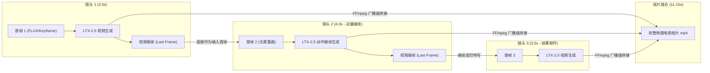

# SKILL_34_CINEMATIC_DIRECTOR_PROMPT_MATRIX.md
# 电影导演与摄影指导矩阵（Cinematic Director & Prompt Matrix）

## 0. 规范定位与痛点背景

### 0.1 传统 AI 短片生成的致命硬伤
在过去的 AI 视频生成流程中，常采用**「单次长时生成（9s–15s one_take）」**或**「多关键帧潜空间强行插值」**模式：
- **物理世界规律破缺（Physics Violation）**：视频扩散模型（如 LTX-2.5）在单次连续潜空间中无法完成瞬间机位切镜或大幅度动作跳转。当在第 0 帧（滑雪站立）、第 72 帧（摔倒俯冲）、第 144 帧（跪坐看天）强行钉入不同关键帧时，模型被迫在中间帧进行**非物理的渐变形变（Morphing/Dissolve）**，导致人物骨骼拉伸、雪板忽隐忽现、甚至出现**半透明幽灵重影（Ghosting）**。
- **影视视听语言缺失（Cinema Grammar Absence）**：真实电影绝不存在 3 秒内同时从平视中景瞬间形变到超低机位特写再变成全景仰视的长镜头。真实的电影张力是通过**剪辑切镜（Cut）**与**镜头连续接续（Continuity）**实现的。

### 0.2 本 Skill 的核心解决方案
整合国际开源电影导演实践（AI-Cinematic-Prompt-Director 250+ 运镜库、ViMax 构图框架、纳逗Pro分块架构）：
1. **废弃单次 9s–15s 融化长镜头**：将 15s 短片拆解为 3–4 个专业镜头（每镜 3–5 秒）。
2. **尾帧接续机制（Last-Frame Continuation）**：动作连贯镜头（如冲坡绊倒 -> 翻滚滑向雪地），Shot N 首帧**直接继承 Shot N-1 的真实视频尾帧**，实现 100% 像素级物理动量连续。
3. **分镜切镜与多角度定妆照（Cut-on-Action & Multi-Angle Sheets）**：景别切换（切到大特写或反打角度）时，遵循 180 度轴线，借助多角度定妆照（正面、3/4侧面、头盔护目镜特写）实现精准一致性。
4. **结构化提示词矩阵（纳逗Pro对齐）**：按视觉风格、场景设定、角色参考、画面构图、运镜、动作物理、音频拟音分块渲染。

---

## 1. 摄影指导规范（Director of Photography / DP）

### 1.1 景别阶梯系统（Shot Scales）
| 景别代码 | 中文名称 | 英文术语 | 构图范围与叙事功能 | 光学与镜头建议 |
| :--- | :--- | :--- | :--- | :--- |
| **ECU** | 大特写 | Extreme Close-Up | 极强情绪张力或细节：护目镜反光、呼吸白雾、雪杖卡扣 | 85mm 微距，浅景深，焦点极其锐利 |
| **CU** | 特写 | Close-Up | 面部神态、头盔与护目镜、人物专注/慌乱情绪 | 50mm 电影大光圈镜头，背景柔美虚化 |
| **MCU** | 中特写 | Medium Close-Up | 胸部以上，面部神态与双手持杖起手式 | 50mm 变形宽银幕（Anamorphic） |
| **MS** | 中景 | Medium Shot | 腰部以上，滑雪身体侧倾、重心动态与雪服质感 | 35mm 变形宽银幕主镜，自然电影视野 |
| **FS** | 全景 | Full Shot | 完整人体、滑雪服全貌、双板与雪道接触点 | 28mm 广角，深景深，交代动作与地面交互 |
| **WS** | 远景 | Wide Shot | 人物在整条雪道上的行进轨迹、高山与松林全景 | 24mm 广角镜头，强调速度与宏大空间 |
| **EWS** | 大远景 | Extreme Wide Shot | 壮丽雪山群峰、空旷山谷、渺小的主角身影 | 18mm 超广角，大景深建立空间 |

### 1.2 视点与机位角度（Camera Angles）
- **eye_level（平视机位）**：自然客观叙事视角。
- **low_angle（低机位仰拍）**：贴近雪面（Skimming the snow surface），极大强化滑雪冲击力、速度感与摔倒张力。
- **high_angle（高机位俯拍）**：俯瞰雪道坡度与滑行雪辙。
- **dutch_angle（荷兰倾斜角）**：画面地平线倾斜 15°–25°，表现失去平衡、失控与危机感。

---

## 2. 运镜指导规范（Camera Movement）

### 2.1 核心法则：单镜单一主运镜矢量（One Dominant Move Per Shot）
扩散视频模型（LTX-2.5）最忌讳在一个镜头内混合旋转、俯仰、推拉，这必然导致潜空间解算崩溃。每个镜头必须且仅包含一个主运镜矢量：

1. **handheld_tracking（手持微晃动态跟镜）**：
   - *Prompt*: `Dynamic handheld tracking camera moving forward alongside the subject, realistic slight organic shake capturing the speed.`
   - *适用*: 中景 MS、全景 FS，极限运动伴随跟拍。
2. **slow_push_in（缓慢推镜）**：
   - *Prompt*: `Camera slowly and smoothly pushes in towards the subject, gradually intensifying emotional and dramatic focus.`
   - *适用*: 特写 CU、中特写 MCU，强化心理聚焦。
3. **dolly_pull_out（匀速拉远）**：
   - *Prompt*: `Camera slowly pulls back and widens, revealing the surrounding expansive snowy landscape and relief.`
   - *适用*: 结果镜头、情绪释怀与全景交代。
4. **low_angle_pan（低机位平移追拍）**：
   - *Prompt*: `Low-angle camera skimming close to the snow surface, panning smoothly to track the rapid skiing action.`
   - *适用*: 捕捉雪板激起的雪浪粒子。
5. **static_lock_off（固定机位锁定）**：
   - *Prompt*: `Static locked-off camera at eye-level, stable framing allowing natural physical tumble and movement within the frame.`
   - *适用*: 剧烈翻滚或停歇，让主体在画框内自然运动。

### 2.2 绝对禁止的破坏性运镜黑名单
- ❌ **Orbit 360° / Arc**（环绕旋转：必然导致人脸或四肢倒置塌陷）
- ❌ **Whip Pan**（快速甩镜：导致潜空间信息丢失为纯色模糊）
- ❌ **Barrel Roll**（滚转翻滚：重力矢量紊乱）
- ❌ **Crash Zoom**（剧烈变焦：产生放射状噪点与形变）

---

## 3. 动作与物理动力学指导（Action Physics & Dynamics）

### 3.1 物理三大守恒原则
1. **动量与惯性守恒（Momentum Conservation）**：
   - 滑雪者高速滑行时具有巨大的向前动量。当雪板交叉绊倒时，身体**绝不会瞬间原地静止**，必须沿原速度矢量向前冲出或滑行翻滚。
2. **重力与碰撞物理（Gravity & Impact Dynamics）**：
   - 重心前倾失控 -> 膝盖跪雪 -> 雪杖脱手受惯性抛飞 -> 身体接触松软粉雪受摩擦阻力逐渐减速。
3. **粉雪流体粒子动力学（Powder Snow Spray & Plume）**：
   - 切雪时两侧翻卷细密雪浪（Fine powder snow spray slicing sideways off the ski edges）；
   - 撞倒时激起爆裂状粉雪气浪（An explosive billowing cloud of soft powder snow erupts into the air, particles settling over jacket and goggles）。

---

## 4. 画面过渡与接续剪辑规范（Shot Transitions & Continuity）

### 4.1 尾帧接续模式（Last-Frame Chain Continuation）


### 4.2 动接动剪辑（Cut on Action）与 180 度轴线
- 当镜头切换到面部特写或反打角度时：
  - **轴线守恒**：滑雪者的运动矢量方向（如在画框内由左向右）在切换中保持同向，严禁越轴。
  - **景别跳切规则**：全景 FS 不直切中景 MS（会产生视觉跳动），应直接切至特写 CU 或极特写 ECU。

---

## 5. 结构化纳逗Pro提示词矩阵模板

每个镜头均生成如下 7 大标准分块，并在 UI/分镜卡片中完整展示：

```text
【视觉风格】自然电影级质感，高对比雪地光影，手持摄影质感，35mm电影宽银幕镜头。
【场景设定】阳光刺眼的高山雪坡，皑皑白雪覆盖的滑雪道，远处可见连绵雪山轮廓。
【角色参考】参考 [滑雪服定妆照] [多角度定妆照] 中的女孩，穿着鲜艳的粉色滑雪服和白色头盔，黑色滑雪镜架在头盔前方。
【画面构图】低机位特写 (Low Angle Close-Up)，主体位于右侧三分线，仰视视角展现雪地上的神情。
【运镜】手持微晃动态跟镜 (Dynamic Handheld Tracking Shot)。
【动作物理】滑雪板意外别刃交叉，身体失去平衡向前滑出，扬起一阵粉雪气浪，重力加速度扑倒在松软雪地上。
【音频拟音】呼啸风声与雪板切雪破风声，冰雪撞击沉闷声，少女轻微急促呼吸声。No dialogue.
```

---

## 6. 代码实现与执行链路

- 核心导演模块：`app.pipelines.cinematic_director`
- 快速成片流水线：`app.pipelines.quick_film`（默认 `mode="cuts"`，自动调用 `_get_video_and_last_frame` 与 FFmpeg 缝合）
- 关键帧挑图与角色一致性：`app.pipelines.frame_select`
- 单元与集成测试：`tests/test_cinematic_director.py`，`tests/test_quick_film.py`
